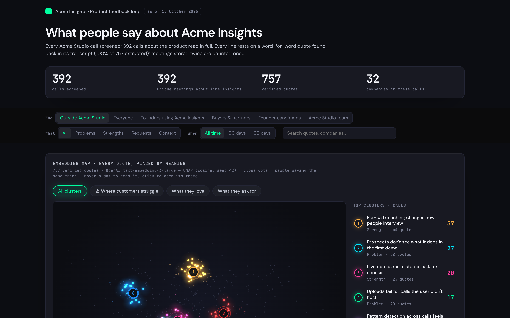
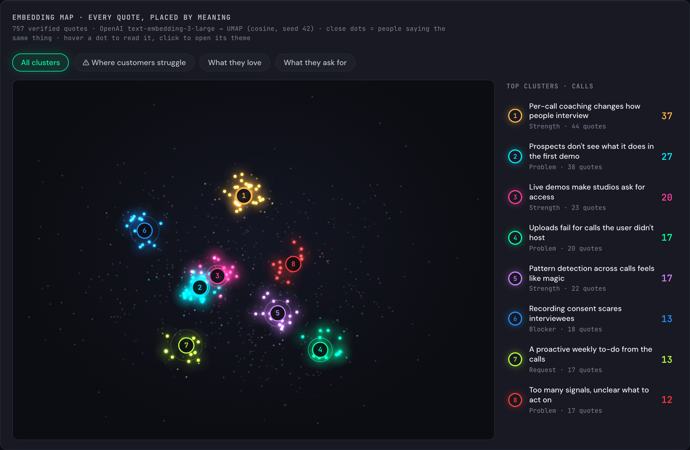
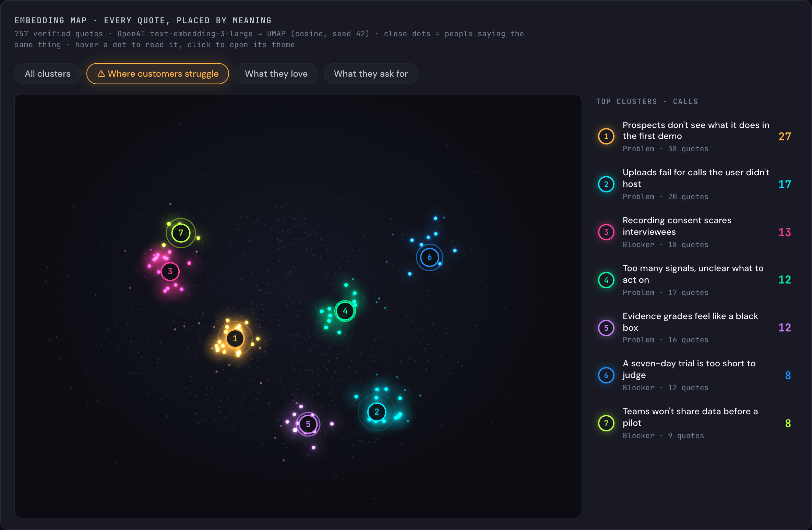
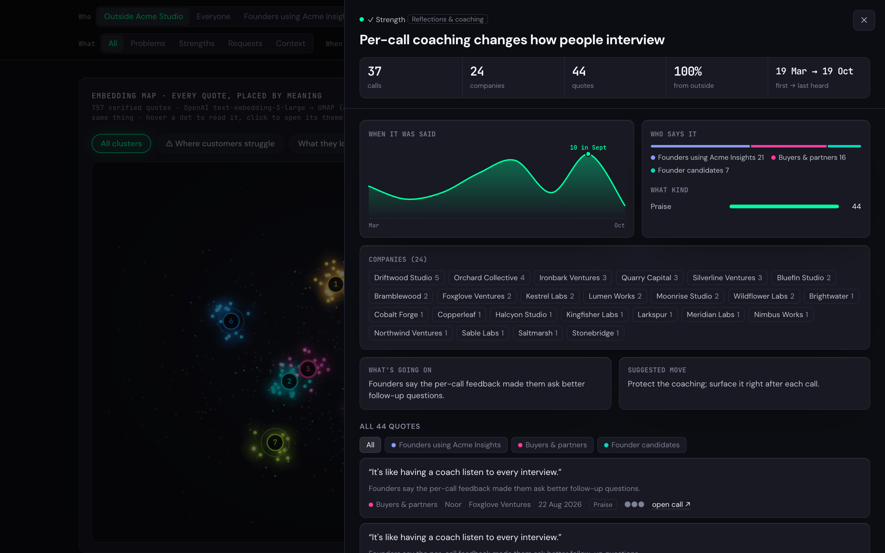
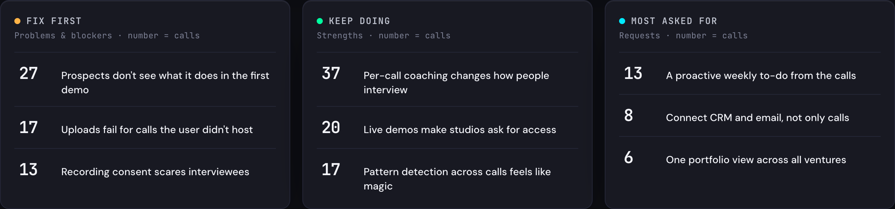
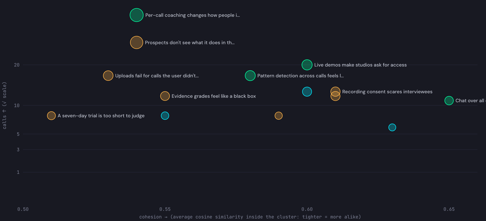
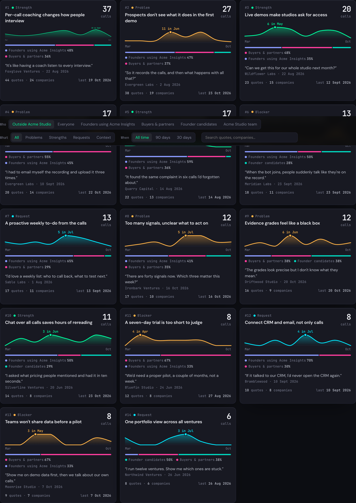

<div align="center">

# Call Feedback Loop

**Turn hundreds of recorded customer calls into a living map of what people really say about your product.**

Every insight rests on a word-for-word quote that is checked against its transcript.<br>
The themes are found by machine learning, not guessed by a prompt.




</div>

---

## Why

Call recorders give you summaries, one call at a time. Product teams need the opposite: **what the same people keep saying across all calls**, ranked, with the receipts.

Call Feedback Loop reads every call, keeps only real product feedback, proves every quote exists, clusters the feedback by meaning and renders it as one self-contained dashboard you can open anywhere.

<table>
<tr>
<td width="50%"></td>
<td width="50%"></td>
</tr>
<tr>
<td><b>Embedding map.</b> Every quote is a dot, placed by meaning. The glowing clusters are what the model found on its own.</td>
<td><b>Where customers struggle.</b> One click switches the whole page to problems and adoption blockers.</td>
</tr>
</table>

## Try it in 30 seconds (no database, no keys)

```bash
npm install
npm run demo
open dist/demo/dashboard.html
```

The demo uses a fully synthetic dataset — a fictional product, fictional companies and fictional quotes — generated by `scripts/demo.ts`.

## What you get



- **Live embedding map** — UMAP over `text-embedding-3-large`, top clusters glow and pulse; hover a dot to read the quote, click to open its theme.
- **Fix first · Keep doing · Most asked for** — the three lists a product meeting actually needs.
- **Every theme opens into its evidence** — calls, companies, first → last heard, who says it, what kind, every quote with a link back to the call.
- **Cluster quality chart** — each cluster by cohesion (how alike its quotes are) and reach (how many calls raised it).
- **Filters everywhere** — who said it (founders, buyers, candidates, your own team), what (problems, strengths, requests), when, and full-text search.

<table>
<tr>
<td width="50%"></td>
<td width="50%"></td>
</tr>
</table>



## How it works

```mermaid
flowchart LR
  A[(Your call database)] -- SELECT only --> B[1 · Pull<br/>call list + product-word hits]
  B --> C[2 · Screen<br/>LLM: is the product discussed?]
  C --> D[3 · Fetch<br/>transcripts of kept calls only]
  D --> E[4 · De-duplicate<br/>same meeting stored twice]
  E --> F[5 · Extract<br/>LLM: every remark + exact quote]
  F --> G[6 · Verify<br/>code finds each quote in the transcript]
  G --> H[7 · Themes<br/>embeddings + average-linkage clustering]
  H --> I[8 · Map<br/>UMAP to 2-D]
  I --> J[9 · Build<br/>one self-contained HTML file]
```



| Stage | File | What happens | AI or code? |
|---|---|---|---|
| Pull | `src/pull.ts` | Lists completed calls and counts product words per call | code (read-only SQL) |
| Screen | `src/screen.ts` | Keeps calls where people talk about the product itself | LLM answers, **code decides** |
| Fetch | `src/fetch.ts` | Downloads transcripts for kept calls only | code |
| De-duplicate | `src/dedupe.ts` | Same day + ≥ 30 % shared 8-word shingles = same meeting, counted once | code |
| Extract | `src/extract.ts` | Every product remark: exact quote, label, area, speaker side | LLM |
| Verify | `src/verify.ts` | Each quote must be found in the transcript, or it is dropped | code |
| Themes | `src/themes.ts` | Names removed → embeddings → average-linkage clustering (cosine ≥ 0.45), per polarity, ≥ 3 calls per theme | **ML**; LLM only writes the name |
| Map | `src/map.ts` | UMAP (cosine, fixed seed) | **ML** |
| Build | `src/build.ts` | Counts everything and writes the dashboard | code |
| Accuracy | `src/check.ts` | 30 random quotes marked right/wrong by a person → measured accuracy on the page | human |

Every stage caches its output, so a weekly re-run only reads new calls.

## Accuracy, not vibes

- **Quotes are proven.** The verifier found 99 % of extracted quotes back in their transcripts on a real run of ~350 calls, and **0 false matches** when pointed at 500 wrong transcripts.
- **Themes are deterministic.** Same data in → same clusters → same numbers. The language model never moves an item between themes.
- **Duplicates are caught.** Meetings imported twice (e.g. a recorder import plus a manual upload) share 56–100 % of their text; different meetings share ≤ 1 %.
- **Accuracy is measured.** `npm run check:make` builds a page of 30 random quotes in their transcript context; a person marks four questions per quote and the score is shown on the dashboard.

## Use it with your own calls

1. **Describe your world** — copy `profile.example.json` to `profile.json` (git-ignored) and fill in your organisation, product name and aliases, your team's names and email domain, and the app URL for "open call" links.
2. **Add secrets** — create `.env` (git-ignored):

   ```bash
   PROD_DIRECT_URL=postgres://readonly-user@host:5432/db
   GEMINI_API_KEY=...
   OPENAI_API_KEY=...
   # optional: ENV_FILE=/path/to/your/app/.env.local  (fills anything not set here)
   ```

3. **Run the loop**

   ```bash
   npm run loop
   open dist/dashboard.html
   ```

The SQL expects a call-intelligence schema with `conversations`, `transcript_segments`, `speakers`, `conversation_speakers`, `companies` and `intelligence_runs` tables; adapt `src/pull.ts` and `src/fetch.ts` to yours.

## Safety by design

**The database is SELECT-only, behind four locks** (`src/db.ts`):

1. If `profile.dbRef` is set, the connection URL must contain it.
2. Only a single `SELECT` / `WITH` statement is accepted; any data-changing keyword is refused.
3. Every query runs in its own `BEGIN READ ONLY … ROLLBACK`.
4. On connect, a no-op `UPDATE` must be **refused** by Postgres before anything else runs.

Read-only is enforced per *transaction*, never per session — a session-level setting can leak through a connection pooler and break the app's writes.

**Your data stays local.** `data/`, `dist/`, `demo-data/`, `.env` and `profile.json` are git-ignored. The dashboard is one offline HTML file; it contains your customers' words, so treat it as confidential.

## Models

| Job | Default | Switch |
|---|---|---|
| Screen, extract, name themes | Gemini 2.5 Pro | `LLM=anthropic` → Claude Opus 5.5 |
| Embeddings | OpenAI `text-embedding-3-large` (cached) | — |
| Map | UMAP (`umap-js`, cosine, seed 42) | — |

## Scripts

| Command | What it does |
|---|---|
| `npm run demo` | Synthetic dataset → `dist/demo/dashboard.html` |
| `npm run loop` | Full pipeline on your data → `dist/dashboard.html` |
| `npm run check:make` / `check:score` | Human accuracy check |
| `npm run screenshots` | Re-render the images in `docs/` from the demo |
| `npm run typecheck` | Strict TypeScript check |

## Configuration

| Setting | Where | Default |
|---|---|---|
| Theme granularity | `THRESHOLD`, `MIN_CALLS` in `src/themes.ts` | 0.45, 3 |
| Parallel LLM calls | `C` env | 8 |
| LLM timeout | `LLM_TIMEOUT_MS` env | 240 000 |
| Re-read all calls after a prompt change | bump `PROMPT_VERSION` in `src/extract.ts` | — |
| Other data / output folders | `DATA_DIR`, `DIST_DIR` env | `data/`, `dist/` |

## License

[MIT](LICENSE)
